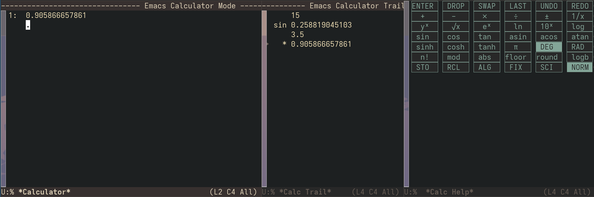

* calc-help-panel.el

Adds a pocket-calculator like help panel for emacs calc. Designed for myself who can never remember the keybindings for commands I don't use often.

** Usage

#+begin_src elisp
(calc-help-panel-mode 1)
#+end_src
